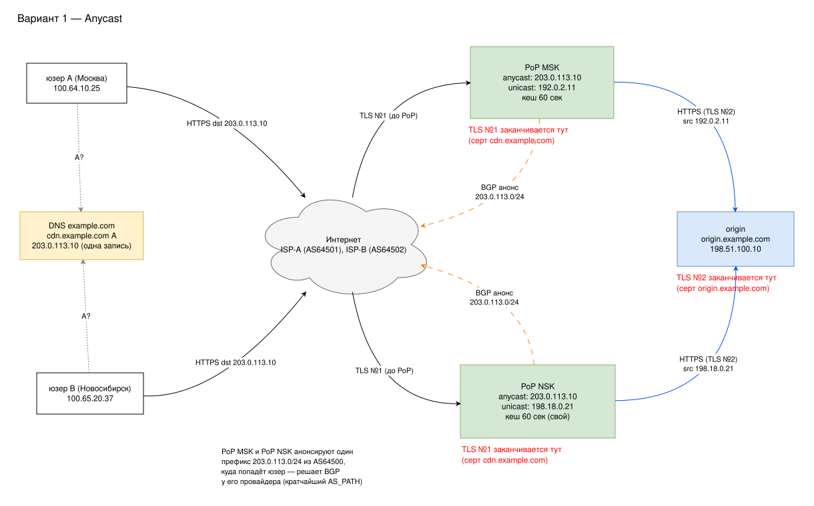
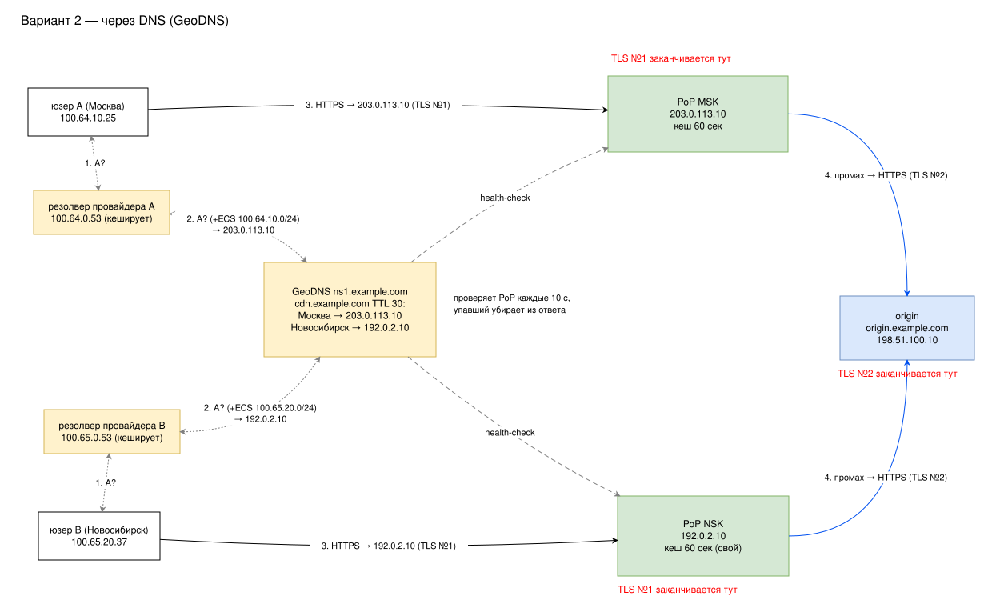

## 1. Схемы

Адреса взяты из диапазонов для документации. Пользователь A в Москве (100.64.10.25), пользователь B в Новосибирске (100.65.20.37), origin — `origin.example.com` (198.51.100.10).

### Anycast

Обе точки анонсируют по BGP один и тот же префикс 203.0.113.0/24 из AS64500, адрес сервиса 203.0.113.10 поднят на обеих. В DNS одна запись для всех, а в какую точку попадёт пользователь, решает BGP у его провайдера. TLS от пользователя завершается на точке CDN, сертификат `cdn.example.com` лежит на обеих. К origin точка ходит со своего обычного unicast-адреса (192.0.2.11 и 198.18.0.21), потому что ответ на anycast-адрес мог бы вернуться в другую точку. Второй TLS завершается уже на origin.

### DNS (GeoDNS)

Здесь у точек разные обычные адреса: MSK — 203.0.113.10, NSK — 192.0.2.10. Пользователь спрашивает имя у резолвера провайдера, тот — у GeoDNS. GeoDNS смотрит на адрес резолвера (или на ECS, если резолвер его передаёт) и отвечает адресом ближайшей живой точки с TTL 30 с. Точки он проверяет раз в 10 с. TLS завершается так же, как в первой схеме: первый на точке CDN, второй на origin.

## 2. Сравнение

| | Anycast | DNS |
|---|---|---|
| Что нужно | своя AS, свой /24, RIR, IRR/RPKI, BGP-сессии с провайдером в каждом регионе | два сервера у любого хостинга и GeoDNS |
| Запуск маленькой CDN | дорого и долго | быстро |
| Точность выбора | по BGP, не по географии; управлять грубо | гибко, но видна география резолвера, а не клиента |
| Кеш DNS | не влияет: запись одна | переключение не быстрее TTL, часть резолверов TTL не соблюдает |
| Отказ точки | трафик уходит сам за время сходимости BGP; если серверы упали, а роутер жив, — «чёрная дыра» | новые ответы DNS без упавшей точки, но старый адрес живёт в кешах |

Для двух точек проще DNS. Anycast окупается, когда точек много и нужна защита от DDoS.

## 3. Кеш

Если в кеше точки есть копия моложе 60 с, она сразу отдаётся пользователю, и к origin точка не ходит. Если копии нет, точка запрашивает origin, отдаёт ответ пользователю и сохраняет его на 60 с; одинаковые запросы при этом склеиваются в один. Если копия есть, но протухла, точка делает условный запрос с `If-None-Match` или `If-Modified-Since`. На `304` она продлевает старую копию, на `200` заменяет её новой.

Разные версии получаются из-за того, что кеши точек независимы и копии в них появились в разное время. Допустим, файл обновили в 12:00:00. В MSK копия взята в 11:59:50 и свежая до 12:00:50, в NSK — в 11:59:20 и свежая до 12:00:20. В 12:00:30 NSK уже отдаёт новую версию, а MSK ещё старую, и такое расхождение может длиться до 60 с. Сверху добавляются кеш браузера и переходы пользователя между точками. Обычно это решают версией в имени файла (`app.3f2a.js`) и принудительной очисткой кеша.

## 4. Отказы

**Origin недоступен.** Здесь обе схемы ведут себя одинаково, потому что origin стоит за точками. Свежие копии отдаются как обычно. На протухшие и отсутствующие точка вернёт `502`/`504`, если только не включён `stale-if-error` — тогда отдаст старую копию. Соединение пользователя с точкой при этом живо, рвётся только соединение точки с origin. Если ответ ещё не начал отдаваться, пользователь получит `502`, а если уже передавался — недокачанный файл.

**Точка недоступна, Anycast.** Анонс из упавшей точки пропадает, и трафик сам уходит во вторую по тому же адресу. Это занимает секунды, а без BFD — до hold-time BGP (90–180 с). Пакеты уже открытых соединений тоже приходят во вторую точку, но она про эти соединения ничего не знает и отвечает `RST`, так что браузеру приходится переподключаться заново.

**Точка недоступна, DNS.** GeoDNS перестаёт отдавать упавшую точку через 10–30 с, но у тех, кто уже получил её адрес, он лежит в кеше до конца TTL, и всё это время их запросы получают таймаут. Спасает, если в ответе DNS сразу оба адреса — тогда браузер сам попробует второй. Открытые соединения рвутся, и при переподключении браузер может снова попасть на мёртвый адрес, пока тот в кеше.

В обеих схемах после отказа точки вторая получает весь трафик с холодным кешем, и запросов к origin становится больше.
